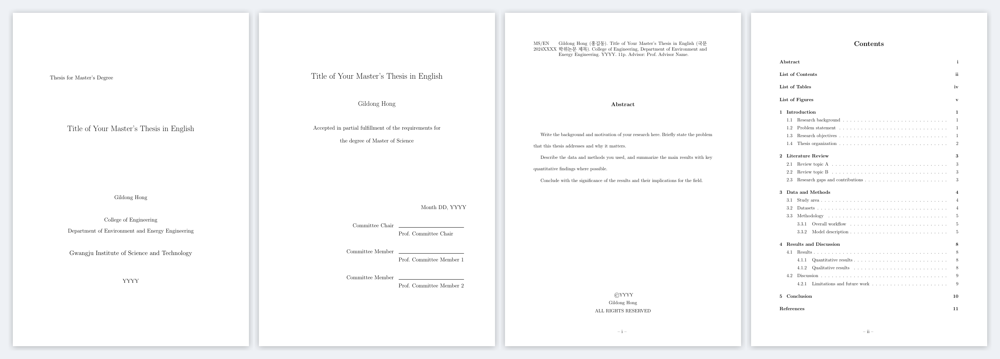
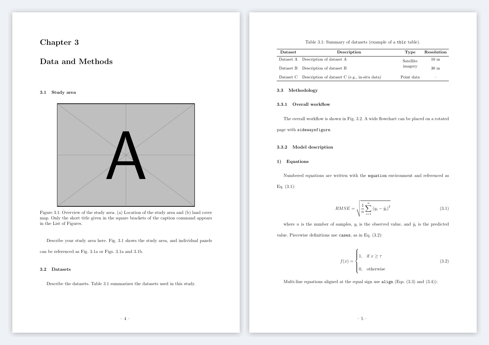

# GIST 학위논문(영문) LaTeX 템플릿

[English](README.md) | **한국어**

[](LICENSE)
[](https://www.latex-project.org/)
[](https://www.overleaf.com/)

- 광주과학기술원(GIST) 학위논문(영문) 템플릿의 Overleaf(LaTeX) 버전임.
- `thesis.tex`에 몇 가지 정보만 입력하면 표지·내표지·제출서·인준지·초록 머리말·목차가 자동으로 만들어짐.
- 본문에는 그림·표·수식·상호참조 예시가 들어 있어, 예시를 본인 내용으로 바꿔 가며 바로 쓸 수 있음.
- 서식을 갖춘 한국어 사용 안내서는 [`docs/guide_ko.pdf`](docs/guide_ko.pdf)에 있음.

> [!IMPORTANT]
> 학교 공식 양식이 **아님**. 제출 전 학교와 학과의 최신 학위논문 작성 지침을 반드시 확인할 것.



## 바뀐 점

**v1.1.0** (2026년 11월 10일)

- 모든 학과에 "College of Engineering"으로 고정 출력되던 단과대학명을 학과별로 자동 출력되게 수정함.
- 학과 코드를 현행 조직(4개 단과대학, 13개 학과)에 맞게 정비하고, 반도체공학과·AI학과·AX학과·수리과학과·융합신경생리학과 코드를 추가함.

**v1.0.0** (2026년 11월 10일)

- 참고문헌(References)이 목차에 나오지 않던 문제 수정함.
- 초록 첫 쪽 번호가 "ii"로 찍히던 문제 수정함 (목차와 동일하게 "i"부터 시작).
- PDF 목차에서 Abstract·Contents 등을 누르면 첫 페이지로 이동하던 링크 문제 수정함.
- 쓰지 않는 패키지는 정리해 주석으로 옮기고, 각 설정에 한글 설명을 붙임.
- 개인 정보와 연구 내용을 모두 지우고, 본문·표·그림·부록을 기능별 예시로 교체함.

## 빠르게 시작하기

### Overleaf에서 사용

1. [Releases](../../releases)에서 `gist_thesis_template_YYYYMMDD.zip`을 받거나, 이 페이지의 **Code → Download ZIP**으로 받음.
2. Overleaf에서 **New Project → Upload Project**를 누르고 zip 파일을 그대로 업로드함.
3. **Menu**에서 **Compiler**는 `pdfLaTeX`, **Main document**는 `thesis.tex`로 지정함.
4. **Recompile**을 누르면 예시 내용이 채워진 논문 PDF(24쪽)가 생성됨.
5. 이후 `thesis.tex`에서 `[EDIT]` 표시를 검색해 본인 정보로 바꾸면 됨.

### 로컬(TeX Live / MiKTeX)에서 사용

```bash
pdflatex thesis
bibtex   thesis
pdflatex thesis
pdflatex thesis
# 또는: latexmk -pdf thesis
```

## 폴더 구조

| 파일 / 폴더 | 내용 |
|:--|:--|
| `thesis.tex` | **메인 문서.** 논문 정보 입력, 패키지 설정, 장 구성 |
| `gist.cls` | GIST 학위논문 클래스. 표지·인준지·초록 머리말·목차 양식 (수정할 필요 없음) |
| `references.bib` | 참고문헌 BibTeX 파일 |
| `chapters/chap1~5.tex` | 본문 각 장 |
| `misc/eabstract.tex` | 영문 초록(Abstract) |
| `misc/kabstract.tex` | 국문요약 (선택, 기본은 출력하지 않음) |
| `misc/acknowledgements.tex` | 감사의 글 |
| `misc/Appendix.tex` | 부록 구성 (`appendix/` 파일을 불러옴) |
| `misc/summary.tex` | Summary 페이지 (선택, 기본은 출력하지 않음) |
| `appendix/A_1~2.tex` | 부록 내용 |
| `tables/` | 표 파일. 본문에서 `\input{tables/파일명}`으로 불러옴 |
| `figures/` | 그림 파일을 넣는 폴더 |
| `docs/guide_ko.pdf` | 한국어 사용 안내서 (PDF) |

## 논문 정보 입력 (`thesis.tex`)

| 명령 | 입력 내용 | 예시 |
|:--|:--|:--|
| `\code` | 학위/학과 코드 (아래 표 참고) | `{{MS/}{EN}}` |
| `\etitle` | 영문 제목. 줄바꿈은 `\titlebreak` 사용 (`\\` 사용 금지) | |
| `\ktitle` | 국문 제목 | |
| `\advisor` / `\kadvisor` | 지도교수 영문 / 한글 이름 (Prof. 등 직함 없이) | |
| `\ename` | 본인 영문 이름 | `Gildong Hong` |
| `\kname` | 본인 한글 이름. **7칸 고정**, 한 글자씩 `{}`로 감싸 오른쪽에 맞춤 | `{}{}{}{}{홍}{길}{동}` |
| `\studentid` | 학번 | `2024XXXX` |
| `\coveryear` | 졸업 연도 | `2027` |
| `\advisorsigndate` | 지도교수 서명일 `{월}{일}{연도}` | `{December}{10}{2026}` |
| `\refereesigndate` | 심사위원 최종 서명일 | |
| `\refereeA`~`C` | 심사위원 영문 이름. 석사 3인(A~C), 박사 5인(A~E). A가 Committee Chair | `Prof. Committee Chair` |

<details>
<summary><b>학위/학과 코드</b> (현행 조직, <a href="https://www.gist.ac.kr/kr/html/sub03/03010101.html">GIST 홈페이지</a> 2026년 11월 10일 확인)</summary>

형식은 `{{학위/}{학과코드}}`임. 학위는 `BS/`(학사), `MS/`(석사), `PhD/`(박사) 중 하나. 아래 단과대학명과 학과명이 표지·제출서·초록 머리말에 자동 출력됨.

| 코드 | 단과대학 | 학과 (영문 출력) | 국문명 |
|:-:|:--|:--|:--|
| `EC` | AI대학 | Department of Electrical Engineering and Computer Science | 전기전자컴퓨터공학과 |
| `AI` | AI대학 | Department of AI | AI학과 |
| `AX` | AI대학 | Department of AX | AX학과 |
| `SE` | AI대학 | Department of Semiconductor Engineering | 반도체공학과 |
| `PH` | 자연과학대학 | Department of Physics and Photon Science | 물리·광과학과 |
| `CH` | 자연과학대학 | Department of Chemistry | 화학과 |
| `MA` | 자연과학대학 | Department of Mathematical Sciences | 수리과학과 |
| `MS` | 공과대학 | Department of Materials Science and Engineering | 신소재공학과 |
| `ME` | 공과대학 | Department of Mechanical and Robotics Engineering | 기계로봇공학과 |
| `EN` | 공과대학 | Department of Environment and Energy Engineering | 환경·에너지공학과 |
| `LS` | 생명·의과학융합대학 | Department of Life Sciences | 생명과학과 |
| `MD` | 생명·의과학융합대학 | Department of Biomedical Science and Engineering | 의생명공학과 |
| `NP` | 생명·의과학융합대학 | Department of Integrative Neuroscience & Physiology | 융합신경생리학과 |

- 예전 조직 코드(`IC`, `IM`, `NA`, `ET`, `CT`, `RT`)는 기존 논문을 다시 컴파일할 때만 쓰도록 `gist.cls`에 남겨 둠.
- 대학원(AI정책전략대학원, 기술경영전문대학원 등)이나 목록에 없는 학과는 `gist.cls`의 학과 블록 하나를 복사해 코드·학과명·단과대학명(`\@ecollege`, `\@kcollege`)을 바꾸면 됨. 단과대학에 속하지 않으면 `\@ecollege`를 비워 두면 해당 줄이 생략됨.

</details>

## 예시로 넣어 둔 기능



| 위치 | 기능 |
|:--|:--|
| `chap1.tex` | 인용(`\cite`), 교차참조(`\Cref`), 약어 매크로(`\eg`, `\ie`, `\etal`), 번호 목록 |
| `chap3.tex` | 부분 그림 라벨(`\phantomsubcaption`), 그림 목차용 짧은 캡션, 가로 회전 그림(`sidewaysfigure`), `tblr` 표(셀 병합), 수식(`equation`, `cases`, `align`) |
| `chap4.tex` | `booktabs` 표(`\multirow`, `\multicolumn`, `\cmidrule`), `subfigure` 환경 |
| `appendix/` | 여러 쪽에 걸치는 표(`longtblr`), 제자리에 고정되는 그림(`\captionof`) |

- 예시 그림(`example-image-a` 등)은 TeX Live와 Overleaf에 기본 내장된 이미지라 별도 파일 없이 표시됨.

## 제출 전 확인할 것

- **여백**: `thesis.tex`의 `\usepackage[margin=1in]{geometry}`가 `gist.cls`의 여백 설정(본문 폭 155 mm)을 덮어씀. 이 상태로 인준받은 선례는 있으나, 학교 최신 지침과 대조해 유지 여부를 결정할 것.
- **국문요약**: 영문 논문에 국문요약이 필요한지 학과·학교 지침을 확인할 것. 필요하면 `thesis.tex`의 `kabstract` 블록 주석을 해제함.
- **단과대학·학과명**: 표지와 초록 머리말에 찍힌 단과대학명과 학과명이 제출 시점의 공식 명칭과 맞는지 확인할 것.
- **쪽수 라벨**: 초록 머리말의 전체 쪽수(`XXp`)는 참고문헌 바로 뒤의 `\label{paperlastpagelabel}`로 계산됨. 삭제하지 말 것.
- **국문 논문**: `gist.cls`에 `korean` 옵션이 있으나 테스트되지 않은 기능임. 사용 시 표지·인준지를 반드시 확인할 것.

## 만든 사람

| 수정자 | 소속 | 수정일 | 연락처 |
|:--|:--|:--|:--|
| 이성준 | 공과대학 환경에너지공학과, 2026년 2월 졸업 | 2026년 11월 10일 | seongjunlee@gm.gist.ac.kr |
| 윤광진 | 전기전자컴퓨터공학부, 2019년 8월 졸업 | 2020년 8월 15일 | yoon28@gist.ac.kr |

- 이 저장소는 **윤광진(Kwangjin Yoon)** 님이 Overleaf 갤러리에 [CC BY 4.0](https://creativecommons.org/licenses/by/4.0/)으로 공개한 **[GIST dissertation template](https://www.overleaf.com/latex/templates/gist-dissertation-template/qkrrkcshdthf)** 을 수정한 것임. 바뀐 내용은 위의 [바뀐 점](#바뀐-점)에 정리함.
- 윤광진 님 버전은 GIST EECS MLV 소속으로 졸업하신 유정민 선배님의 템플릿을 바탕으로 함.
- `gist.cls`는 `kaist.cls`에서 출발해 S.H. Lee, Y. Chung 님이 1996~2000년에 관리한 클래스이며, 수정 이력은 파일 머리 주석에 그대로 남겨 둠.

## 라이선스

- 원본과 같은 [크리에이티브 커먼즈 저작자표시 4.0 국제 라이선스(CC BY 4.0)](LICENSE)로 배포함.
- 출처를 밝히고 변경 사항을 표시하면 본인 학위논문 작성을 포함해 자유롭게 사용·수정·재배포할 수 있음.
- 이 템플릿으로 작성한 논문 내용(본문·그림·데이터)은 작성자 본인의 것이며, 이 라이선스의 적용 대상이 아님.
