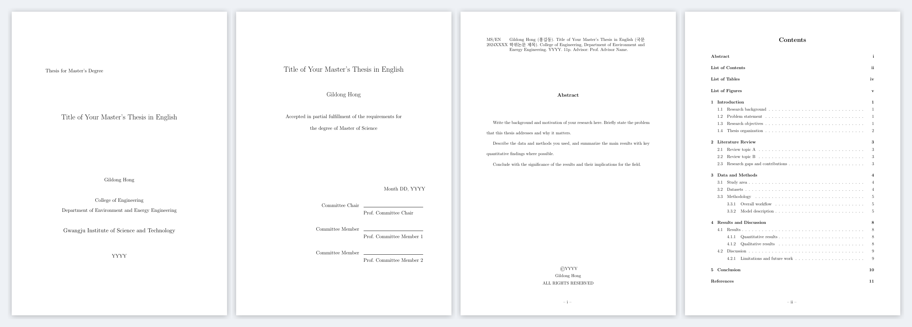
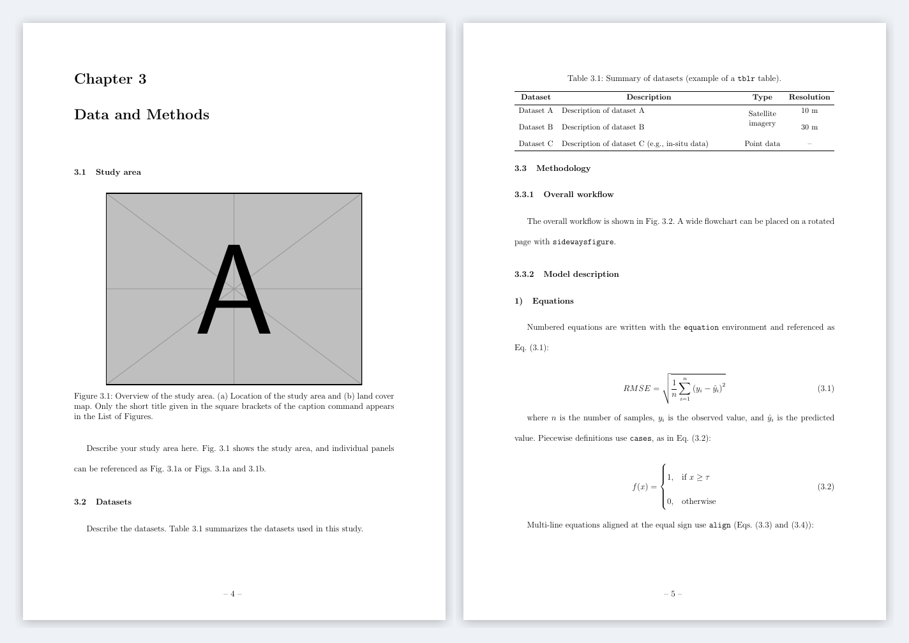

# GIST Thesis Template (English)

**English** | [한국어](README.ko.md)

[](LICENSE)
[](https://www.latex-project.org/)
[](https://www.overleaf.com/)

A LaTeX template for theses written in English at the **Gwangju Institute of Science and Technology (GIST)**, ready to use on Overleaf or a local TeX installation. It generates the cover, inner title page, submission page, committee approval page, abstract header, and table of contents from a few fields in `thesis.tex`. The body chapters contain working examples of figures, tables, equations, and cross-references, so you can start by replacing them with your own content.

> [!IMPORTANT]
> This is **not an official GIST template**. Check the latest thesis guidelines from GIST and your department before submission.



## What's new

**v1.1.0** (2026-11-10)

- The college on the cover, submission page, and abstract header now follows the department. It was fixed to "College of Engineering" for every department.
- Department codes were updated to the current organization (4 colleges, 13 departments), with new codes for Semiconductor Engineering, AI, AX, Mathematical Sciences, and Integrative Neuroscience & Physiology.

**v1.0.0** (2026-11-10)

- References now appear in the table of contents.
- The first abstract page is numbered **i**, matching the table of contents (it was printed as ii).
- PDF bookmarks for Abstract, Contents, and the lists now jump to the correct page.
- Unused packages were moved into commented, optional blocks, and each setting has a short comment.
- All personal and research content was removed. The chapters, tables, figures, and appendix were replaced with feature examples.

## Quick start

### Overleaf

1. Download `gist_thesis_template_YYYYMMDD.zip` from [Releases](../../releases), or use **Code → Download ZIP** on this page.
2. In Overleaf, choose **New Project → Upload Project** and upload the zip file as is.
3. Under **Menu**, set **Compiler** to `pdfLaTeX` and **Main document** to `thesis.tex`.
4. Click **Recompile**. A 24-page sample thesis is produced.
5. Search `thesis.tex` for `[EDIT]` and replace each marked field with your information.

### Local build (TeX Live / MiKTeX)

```bash
pdflatex thesis
bibtex   thesis
pdflatex thesis
pdflatex thesis
# or: latexmk -pdf thesis
```

## Repository structure

| Path | Contents |
|:--|:--|
| `thesis.tex` | **Main file.** Thesis information, packages, chapter list |
| `gist.cls` | GIST thesis class: cover, approval pages, abstract header, contents (no edits needed) |
| `references.bib` | BibTeX database |
| `chapters/chap1–5.tex` | Body chapters |
| `misc/eabstract.tex` | Abstract (English) |
| `misc/kabstract.tex` | Korean abstract (optional, disabled by default) |
| `misc/acknowledgements.tex` | Acknowledgements |
| `misc/Appendix.tex` | Appendix layout (loads `appendix/`) |
| `misc/summary.tex` | Summary page (optional, disabled by default) |
| `appendix/A_1–2.tex` | Appendix content |
| `tables/` | Table files, loaded with `\input{tables/<file>}` |
| `figures/` | Put your figure files here |
| `docs/guide_ko.pdf` | Formatted user guide in Korean |

## Thesis information (`thesis.tex`)

| Command | What to enter | Example |
|:--|:--|:--|
| `\code` | Degree / department code (see below) | `{{MS/}{EN}}` |
| `\etitle` | English title. Use `\titlebreak` for line breaks, not `\\` | |
| `\ktitle` | Korean title | |
| `\advisor` / `\kadvisor` | Advisor's name in English / Korean, without "Prof." | |
| `\ename` | Your name in English | `Gildong Hong` |
| `\kname` | Your name in Korean: **7 fixed slots**, one character per `{}`, right-aligned | `{}{}{}{}{홍}{길}{동}` |
| `\studentid` | Student ID | `2024XXXX` |
| `\coveryear` | Year of graduation | `2027` |
| `\advisorsigndate` | Advisor's signing date `{Month}{Day}{Year}` | `{December}{10}{2026}` |
| `\refereesigndate` | Committee's final signing date | |
| `\refereeA`–`C` | Committee members. Master's: A–C, Ph.D.: A–E. A is the Committee Chair | `Prof. Committee Chair` |

<details>
<summary><b>Department codes</b> (current organization, checked against <a href="https://www.gist.ac.kr/en/html/sub03/03010101.html">gist.ac.kr</a> on 2026-11-10)</summary>

The format is `{{degree/}{code}}`, where the degree is `BS/`, `MS/`, or `PhD/`. The college and department below are printed on the cover, submission page, and abstract header.

| Code | College | Department (printed) | Korean name |
|:-:|:--|:--|:--|
| `EC` | College of Artificial Intelligence | Department of Electrical Engineering and Computer Science | 전기전자컴퓨터공학과 |
| `AI` | College of Artificial Intelligence | Department of AI | AI학과 |
| `AX` | College of Artificial Intelligence | Department of AX | AX학과 |
| `SE` | College of Artificial Intelligence | Department of Semiconductor Engineering | 반도체공학과 |
| `PH` | College of Natural Sciences | Department of Physics and Photon Science | 물리·광과학과 |
| `CH` | College of Natural Sciences | Department of Chemistry | 화학과 |
| `MA` | College of Natural Sciences | Department of Mathematical Sciences | 수리과학과 |
| `MS` | College of Engineering | Department of Materials Science and Engineering | 신소재공학과 |
| `ME` | College of Engineering | Department of Mechanical and Robotics Engineering | 기계로봇공학과 |
| `EN` | College of Engineering | Department of Environment and Energy Engineering | 환경·에너지공학과 |
| `LS` | College of Life Sciences and Medical Engineering | Department of Life Sciences | 생명과학과 |
| `MD` | College of Life Sciences and Medical Engineering | Department of Biomedical Science and Engineering | 의생명공학과 |
| `NP` | College of Life Sciences and Medical Engineering | Department of Integrative Neuroscience & Physiology | 융합신경생리학과 |

- Legacy codes from the former organization (`IC`, `IM`, `NA`, `ET`, `CT`, `RT`) remain in `gist.cls` only so that older theses still compile.
- For a graduate school (e.g., Graduate School of AI Policy and Strategy, Graduate School of Management of Technology) or a department not listed here, copy one department block in `gist.cls` and change the code, department name, and college (`\@ecollege`, `\@kcollege`). If the unit does not belong to a college, leave `\@ecollege` empty and the college line is omitted.

</details>

## Examples included



| File | Features |
|:--|:--|
| `chap1.tex` | Citations (`\cite`), cross-references (`\Cref`), abbreviation macros (`\eg`, `\ie`, `\etal`), numbered lists |
| `chap3.tex` | Sub-panel labels (`\phantomsubcaption`), short captions for the list of figures, rotated full-page figure (`sidewaysfigure`), `tblr` table with merged cells, equations (`equation`, `cases`, `align`) |
| `chap4.tex` | `booktabs` table (`\multirow`, `\multicolumn`, `\cmidrule`), `subfigure` environment |
| `appendix/` | Multi-page table (`longtblr`), non-floating figures (`\captionof`) |

The sample images (`example-image-a`, etc.) ship with TeX Live and Overleaf, so no image files are needed until you add your own.

## Before submission

- **Margins.** `\usepackage[margin=1in]{geometry}` in `thesis.tex` overrides the margins defined in `gist.cls` (155 mm text width). A thesis has been approved with this setting, but compare it with the current GIST guidelines.
- **Korean abstract.** Check whether your department requires one. To enable it, uncomment the `kabstract` block in `thesis.tex`.
- **College and department.** Confirm that the college and department printed on the cover and abstract header match the official names at the time of submission.
- **Page count.** The total page count in the abstract header (`XXp`) comes from `\label{paperlastpagelabel}` right after the references. Do not delete it.
- **Theses in Korean.** `gist.cls` has a `korean` class option, but it has not been tested. If you use it, check the cover and approval pages carefully.

## Credits

| Contributor | Affiliation | Date | Contact |
|:--|:--|:--|:--|
| Seongjun Lee | Dept. of Environment and Energy Engineering (M.S., Feb. 2026) | 2026-11-10 | seongjunlee@gm.gist.ac.kr |
| Kwangjin Yoon | School of EECS (Aug. 2019) | 2020-08-15 | yoon28@gist.ac.kr |

- This repository is adapted from **[GIST dissertation template](https://www.overleaf.com/latex/templates/gist-dissertation-template/qkrrkcshdthf)** by **Kwangjin Yoon**, published in the Overleaf Gallery under [CC BY 4.0](https://creativecommons.org/licenses/by/4.0/). The changes are listed in [What's new](#whats-new).
- Kwangjin Yoon's version was itself based on an earlier template by 유정민 (GIST EECS MLV alumnus).
- `gist.cls` descends from `kaist.cls` and was maintained by S.H. Lee and Y. Chung (1996–2000). Its modification history is kept in the file header.

## License

This template is distributed under the [Creative Commons Attribution 4.0 International License (CC BY 4.0)](LICENSE), the same license as the original Overleaf template. You may use, modify, and redistribute it, including in your own thesis, as long as you give appropriate credit and indicate any changes.

Your thesis content (text, figures, data) belongs to you and is not covered by this license.
